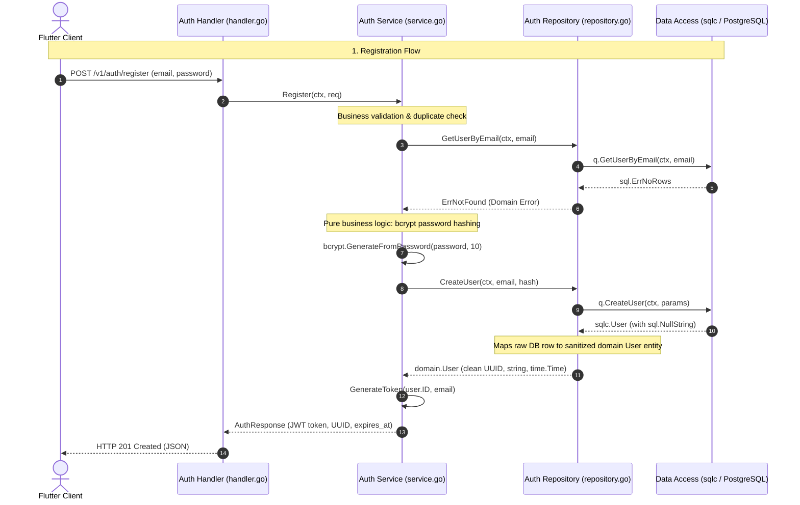

# Subject-Matter Guide: Authentication, JWT Security, & Multi-Tenancy

## 1. Concept & Systems 'Why'

### 1.1 Stateless JWTs vs. Stateful Database Sessions
In backend architectures, there are two primary session paradigms:
- **Stateful Server Sessions:** The server generates a random session ID, writes it to a Redis or PostgreSQL `sessions` table, and checks the database on every HTTP request.
  - *Problem:* Every single API call incurs a database roundtrip simply to verify identity, creating an I/O bottleneck at scale.
- **Stateless Cryptographic JWTs (RFC 7519):** The server signs the user's identity (`user_id`, email, expiration) using an HMAC-SHA256 secret.
  - *Advantage:* Any backend instance can verify the signature locally in microseconds using CPU math without querying the database, enabling horizontal scalability and sub-millisecond middleware checks.

### 1.2 Password Hashing: Why Bcrypt?
Passwords must **never** be stored in plaintext or hashed with fast cryptographic digests (like MD5 or SHA-256):
- Modern GPUs can calculate billions of SHA-256 hashes per second, making brute-force attacks trivial.
- **Bcrypt is an adaptive, slow hash algorithm:** It incorporates a salt (preventing rainbow-table attacks) and a configurable work factor (`cost = 10` by default in Go). This forces an attacker to spend significant CPU cycles on each guess, rendering brute-force attacks economically and computationally infeasible.

### 1.3 Multi-Tenant Isolation via Go's `context.Context`
In Wordivate, learning conversations and vocabulary libraries are private to the individual learner (SRS Section 4.3, NFR-S2).
- **The Vulnerability:** If handlers rely on client-supplied route parameters (e.g., `POST /v1/words?user_id=123`), an attacker can tamper with the ID and read or mutate other users' vocabulary.
- **The Solution:** The authenticated `user_id` is extracted strictly from the verified JWT cryptographic signature in the middleware and injected into Go's request `context.Context`. Every domain service and repository query receives this context and enforces `WHERE user_id = $1`.

---

## 2. Authentication & 4-Tier Clean Architecture Request Flow



---

## 3. Go Mechanics Deep-Dive

### 3.1 Unexported Context Keys (Preventing Key Collisions)
Go's `context.Context` is a key-value store where keys are compared by interface equality:
```go
// BAD: Prone to accidental overwrites if another package uses "user_id"
ctx = context.WithValue(ctx, "user_id", userID)

// GOOD: Unexported private struct type guarantees 100% collision immunity
type contextKey struct{}
var userIDKey = contextKey{}

ctx = context.WithValue(ctx, userIDKey, userID)
```
Because `contextKey` is unexported in `internal/middleware`, external packages cannot tamper with or overwrite this context value.

### 3.2 Clear Separation: Domain Errors vs. HTTP Status Codes
Domain services in `internal/features/auth/` know **nothing** about HTTP status codes:
- The service returns typed sentinel errors: `ErrInvalidCredentials`, `ErrUserAlreadyExists`, `ErrPasswordTooShort`.
- The handler inspects errors using `errors.Is(err, ...)` and maps them to appropriate HTTP codes (`401 Unauthorized`, `409 Conflict`, `400 Bad Request`).
- This keeps the domain service cleanly testable without mocking HTTP requests.

---

## 4. Verification & Testing

### 4.1 Running the Automated Test Suite
Execute the unit tests covering validation, bcrypt hashing, token generation, and middleware interception:
```bash
cd backend
go test -v ./internal/features/auth/... ./internal/middleware/...
```

### 4.2 Manual Verification with `curl`

1. **Register a New Learner:**
   ```bash
   curl -X POST http://localhost:8080/v1/auth/register \
     -H "Content-Type: application/json" \
     -d '{"email":"learner@wordivate.com","password":"secretPassword123!"}'
   ```
   *Expected Response:* `HTTP 201 Created` with a signed JWT token and user UUID.

2. **Authenticate with Credentials:**
   ```bash
   curl -X POST http://localhost:8080/v1/auth/login \
     -H "Content-Type: application/json" \
     -d '{"email":"learner@wordivate.com","password":"secretPassword123!"}'
   ```
   *Expected Response:* `HTTP 200 OK` with session token.

3. **Access a Protected Route Without a Token:**
   ```bash
   curl -i http://localhost:8080/v1/words/commit
   ```
   *Expected Response:* `HTTP 401 Unauthorized` (`{"error":"missing authorization header"}`).

4. **Access Protected Route with Valid Bearer Token:**
   ```bash
   curl -i http://localhost:8080/v1/recall/due \
     -H "Authorization: Bearer <YOUR_JWT_TOKEN>"
   ```
   *Expected Response:* `HTTP 200 OK`.

---

## 5. Architectural Standards: Strict 4-Tier Clean Layering

Authentication enforces the Wordivate 4-tier Clean Architecture invariant:

```
Tier 1: Data Access (internal/database/sqlc/)
       |  (Type-safe compiled queries)
       v
Tier 2: Repository Layer (internal/features/auth/repository.go)
       |  (Encapsulates sqlc, maps sql.NullString -> domain.User)
       v
Tier 3: Service Layer (internal/features/auth/service.go)
       |  (Pure business logic, bcrypt, JWT, depends ONLY on UserRepository)
       v
Tier 4: Handler Layer (internal/features/auth/handler.go)
          (HTTP status codes, JSON serialization)
```

### Architectural Guarantees:
1. **Zero Database Leaks into Services:** `service.go` has zero imports of `database/sql`, `internal/database`, or `internal/database/sqlc`. It has no knowledge of database connection pools.
2. **Sanitized Domain Entities:** The service receives a clean `User` entity containing native Go primitives (`string`, `uuid.UUID`, `time.Time`) rather than relational database null structs (`sql.NullString`).
3. **Frictionless Unit Testing:** Because the service depends on the `UserRepository` interface, testing registration and login flows requires no live PostgreSQL instance and no mock database drivers—a 15-line in-memory mock repository runs the entire test suite in sub-milliseconds.

