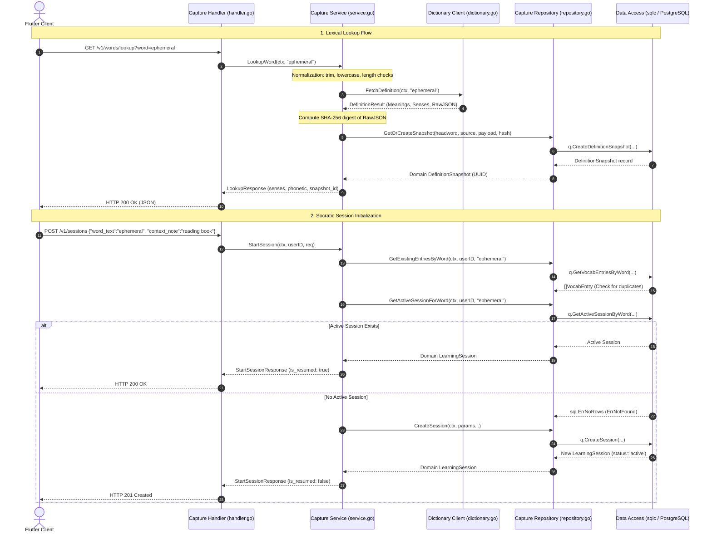

# Subject-Matter Guide: Word Capture, Lexical Snapshots, & Session Initialization

## 1. Concept & Systems 'Why'

### 1.1 Why Immutable Definition Snapshots (`definition_snapshots`)?
When an application integrates with third-party dictionary APIs (e.g., Free Dictionary API, Oxford, Merriam-Webster), definitions are subject to external drift:
- Third-party APIs change definition wording, reorder senses, or remove historical senses.
- If a user engaged in a Socratic dialogue regarding a specific nuance of *"ephemeral"*, and the external dictionary provider later edits that entry, the historical learning session would lose its contextual grounding.
- **The Solution (SRS Section 7.4, 9):** The Wordivate backend captures an immutable **Definition Snapshot** at the moment of lookup. The raw JSON payload is preserved alongside a **SHA-256 cryptographic digest** (`content_hash`). All subsequent sessions, revisions, and vocabulary entries point immutably to this snapshot via foreign key (`snapshot_id`), guaranteeing 100% auditability and reproducible evaluation.

### 1.2 Lexical Normalization
Users input words in varied casings, with accidental whitespace or punctuation:
- `"  Ephemeral "` -> normalized to `"ephemeral"`
- `"SERENDIPITY\t"` -> normalized to `"serendipity"`
- Words must be between 1 and 100 characters in length. Any control characters (`\n`, `\r`, `\x00`) are rejected immediately with `HTTP 400 Bad Request`.

### 1.3 Duplicate Awareness vs. Active Session Idempotency
- **Duplicate Vocabulary Detection (SRS FR-004):** If a user attempts to capture a word they have already committed to their vocabulary library (`vocab_entries`), the system alerts the client and returns the list of existing entry IDs and senses.
- **Active Session Resumption (SRS Section 7.4):** PostgreSQL enforces a partial unique index `one_active_session_per_word`:
  ```sql
  CREATE UNIQUE INDEX one_active_session_per_word
  ON learning_sessions (user_id, headword_key)
  WHERE status = 'active';
  ```
  If the user calls `POST /v1/sessions` for a word where an active session already exists, the server idempotently resumes that session (`is_resumed: true`, `HTTP 200 OK`) rather than creating a duplicate session or failing with a 500 error.

---

## 2. 4-Tier Clean Architecture Request Flow



---

## 3. Go Engineering Mechanics & Design Patterns

### 3.1 Content-Addressable Storage via SHA-256
In `capture/dictionary.go`:
```go
func ComputeContentHash(payload []byte) []byte {
    hash := sha256.Sum256(payload)
    return hash[:]
}
```
Using the cryptographic hash ensures that two queries resulting in identical lexical content will match the unique constraint `(source, headword_key, content_hash)`, preventing duplicate storage bloat while guaranteeing payload integrity.

### 3.2 Resilience and Timeouts in HTTP Clients
External network calls must never run indefinitely. The `httpDictionaryClient` configures a hard context timeout (`5 * time.Second`):
```go
req, err := http.NewRequestWithContext(ctx, http.MethodGet, endpoint, nil)
```
If the external dictionary API hangs or drops packets, the context cancels automatically, mapping cleanly to `ErrDictionaryUnavailable` (HTTP 502 Bad Gateway) rather than causing request goroutine leaks.

---

## 4. Verification & Testing

### 4.1 Automated Unit Tests
Run the complete unit test suite:
```bash
go test -v ./internal/features/capture/...
```
*Output:*
```text
=== RUN   TestNormalization
--- PASS: TestNormalization (0.00s)
=== RUN   TestLookupWord
--- PASS: TestLookupWord (0.00s)
=== RUN   TestStartSessionFreshAndResumed
--- PASS: TestStartSessionFreshAndResumed (0.00s)
=== RUN   TestDuplicateEntryAwareness
--- PASS: TestDuplicateEntryAwareness (0.00s)
PASS
```

### 4.2 Manual Verification with `curl`

1. **Lookup an Unfamiliar Word:**
   ```bash
   curl -i "http://localhost:8080/v1/words/lookup?word=ephemeral" \
     -H "Authorization: Bearer <VALID_JWT_TOKEN>"
   ```
   *Expected Response:* `HTTP 200 OK` with `snapshot_id`, phonetic, and structured senses.

2. **Start a New Socratic Learning Session:**
   ```bash
   curl -i -X POST http://localhost:8080/v1/sessions \
     -H "Authorization: Bearer <VALID_JWT_TOKEN>" \
     -H "Content-Type: application/json" \
     -d '{"word_text":"ephemeral","context_note":"Found in an essay on memory"}'
   ```
   *Expected Response:* `HTTP 201 Created` with `session_id`, `status: "active"`, and `is_resumed: false`.

3. **Verify Session Idempotency (Repeat Request):**
   ```bash
   curl -i -X POST http://localhost:8080/v1/sessions \
     -H "Authorization: Bearer <VALID_JWT_TOKEN>" \
     -H "Content-Type: application/json" \
     -d '{"word_text":"ephemeral"}'
   ```
   *Expected Response:* `HTTP 200 OK` with the exact same `session_id` and `is_resumed: true`.
