# Transactional Commit, Idempotency, & Persistent Vocabulary Library

This document provides architectural, pedagogical, and technical documentation for Sprint 5 of the Wordivate backend in Go. It covers atomic multi-table commit transactions, idempotency-key deduplication, personal definition provenance, audit revision tracking, and PostgreSQL weighted full-text search.

---

## 1. Concept & Systems 'Why'

### 1.1 The Atomicity Mandate: Committing Knowledge
In Wordivate, moving an active Socratic learning dialogue into the learner's persistent vocabulary library is not a single table update. It requires orchestrating changes across four distinct database domains:
1. **`vocab_entries`:** The primary vocabulary entity storing definitions, part of speech, understanding flags, and weighted search vectors.
2. **`entry_revisions`:** An immutable audit ledger capturing initial committed values (revision 1) and every subsequent post-commit edit.
3. **`commit_assessments`:** The AI tutor's structured evaluation verdict (`sufficient | partial | inaccurate`), reasoning, and discrepancy notes.
4. **`learning_sessions`:** Transitioning the active session to `committed`, recording `ended_at = now()`, and establishing the circular foreign key to `entry_id`.

> **Systems Problem:** If a server process crashes, network drops, or database constraint triggers after writing to `vocab_entries` but before recording `entry_revisions` or marking the session `committed`, the database enters a corrupt, inconsistent state. The session remains open, and orphan entries appear.

**Solution:** Wordivate encapsulates this entire multi-table sequence in a single PostgreSQL ACID transaction (`BEGIN` ... `COMMIT`). If any individual operation fails, the entire transaction rolls back cleanly, leaving zero partial artifacts.

### 1.2 Separation of Official and Personal Definitions (Cardinal Rule #1)
*Think of it like an architect's blueprint versus a carpenter's field notes.*
- **Official Definition:** Grounded in an immutable dictionary snapshot (`definition_snapshots`), verified with SHA-256 cryptographic hashing. It reflects objective linguistic reality.
- **Personal Definition:** Authored or approved by the user, rooted strictly in their own conversational statements during the Socratic session. It represents their subjective mental model.

Wordivate stores these two definitions in distinct database columns (`official_definition` and `personal_definition`). They are displayed side-by-side in the user interface and are **never merged**. If the user's mental model conflicts with reality, the system flags the entry with `understanding_flag = 'needs_review'` and records a `discrepancy_note`, preserving honesty without overriding learner autonomy.

### 1.3 Idempotent API Design on Mobile Networks
Mobile devices frequently operate on unstable cellular radios. A classic distributed systems failure occurs when:
1. The user taps **Commit**.
2. The server successfully writes the database transaction.
3. The cellular tower drops the TCP connection before the HTTP 201 response reaches the phone.
4. The client or user automatically retries the request.

Without idempotency, the retry causes duplicate vocabulary entries or unique constraint collisions (`UNIQUE (user_id, headword_key, sense_key)`). 
Wordivate requires an `Idempotency-Key` HTTP header for mutating commits. The server computes a SHA-256 hash of the request body and persists the response in `idempotency_keys`. If a duplicate request arrives, the server immediately returns the cached response with `is_duplicate: true`, completely transparent to the user.

### 1.4 PostgreSQL Weighted Full-Text Search
Traditional SQL `LIKE` or `ILIKE '%term%'` performs costly full-table sequential scans and fails on word stems (e.g. searching "fleeting" won't match "fleet"). 
Wordivate uses PostgreSQL's native `search_vector` generated column indexed with a Generalized Inverted Index (**GIN**):
```sql
search_vector TSVECTOR GENERATED ALWAYS AS (
    setweight(to_tsvector('english', word_text), 'A') ||
    setweight(to_tsvector('english', personal_definition), 'B') ||
    setweight(to_tsvector('english', coalesce(contextual_notes, '')), 'C')
) STORED
```
- **Weight A:** Headword matches (highest relevance rank).
- **Weight B:** Personal definition matches.
- **Weight C:** Contextual notes matches.
Searches run via `websearch_to_tsquery('english', $query)` in sub-millisecond time (< 500 ms p95, satisfying NFR-P3).

---

## 2. Go Implementation Deep-Dive

### 2.1 Managing PostgreSQL Transactions Safely with `defer`
In Go, writing transactions requires rigorous error safety to prevent abandoned locks and connection pool leaks:

```go
func (r *sqlRepository) CommitSessionTx(ctx context.Context, params CommitTxParams) (*VocabEntry, *CommitAssessment, error) {
    tx, err := r.db.BeginTx(ctx, nil)
    if err != nil {
        return nil, nil, fmt.Errorf("beginning commit transaction: %w", err)
    }
    // Safety Net: defer Rollback immediately after BeginTx.
    // If tx.Commit() succeeds below, Rollback() becomes a harmless no-op returning sql.ErrTxDone.
    // If any error occurs or a panic triggers, Rollback() guarantees immediate abort.
    defer tx.Rollback()

    qtx := r.q.WithTx(tx)

    // 1. Insert vocabulary entry into vocab_entries
    entryRow, err := qtx.CreateVocabEntry(ctx, ...)
    if err != nil {
        return nil, nil, fmt.Errorf("inserting vocab entry: %w", err)
    }

    // 2. Insert initial revision 1 into entry_revisions
    _, err = qtx.CreateEntryRevision(ctx, ...)
    if err != nil {
        return nil, nil, fmt.Errorf("inserting entry revision 1: %w", err)
    }

    // 3. Insert AI commit assessment into commit_assessments
    _, err = qtx.CreateCommitAssessment(ctx, ...)
    if err != nil {
        return nil, nil, fmt.Errorf("inserting commit assessment: %w", err)
    }

    // 4. Link session to entry and transition status = 'committed'
    _, err = qtx.LinkSessionToEntry(ctx, ...)
    if err != nil {
        return nil, nil, fmt.Errorf("linking session to entry: %w", err)
    }

    // 5. Commit atomic transaction
    if err := tx.Commit(); err != nil {
        return nil, nil, fmt.Errorf("committing atomic transaction: %w", err)
    }

    return mapVocabEntry(entryRow), mappedAssessment, nil
}
```

### 2.2 Idempotency Caching Engine
```go
cleanKey := strings.TrimSpace(idempotencyKey)
if cleanKey != "" {
    existingKey, err := s.repo.GetIdempotencyKey(ctx, userID, cleanKey)
    if err == nil && existingKey != nil {
        if len(existingKey.Response) > 0 {
            var cachedResp CommitSessionResponse
            if err := json.Unmarshal(existingKey.Response, &cachedResp); err == nil {
                cachedResp.IsDuplicate = true
                return &cachedResp, nil
            }
        }
        return nil, errors.New("concurrent mutation with identical idempotency key in progress")
    }
    _ = s.repo.CreateIdempotencyKey(ctx, userID, cleanKey, requestHash)
}
```

---

## 3. Architecture & Lifecycle Flows

### 3.1 Transactional Commit Lifecycle



#### Step-by-Step Architectural Walkthrough:
1. **Commit Draft Generation:** Learner initiates review via `POST /v1/sessions/{id}/commit-draft`. Service inspects dialogue history, evaluates comprehension against the immutable snapshot, and generates a candidate personal definition and verdict.
2. **User Autonomy & Review:** Learner reviews the AI verdict, optionally refines their personal definition, and confirms persistence.
3. **Idempotency Gate:** Client submits `POST /v1/sessions/{id}/commit` carrying a unique `Idempotency-Key` header.
4. **Cache Interception:** Service computes SHA-256 hash of the request payload. If a previous completed commit matches this key, the cached response is immediately returned with `is_duplicate: true` (HTTP 200).
5. **Atomic Transaction Boundary (`sql.Tx`):**
   - **Step 11a:** `INSERT INTO vocab_entries` creates the permanent vocabulary entry (official definition, personal definition, origin, understanding flag, full-text vector).
   - **Step 11b:** `INSERT INTO entry_revisions` writes initial audit revision (`rev_no = 1`) capturing snapshot and definition states.
   - **Step 11c:** `INSERT INTO commit_assessments` persists AI evaluation metrics and discrepancy notes.
   - **Step 11d:** `UPDATE learning_sessions` links the session to the new entry and transitions status to `committed`.
   - **Step 11e:** `tx.Commit()` executes all four mutations atomically; failure in any operation aborts and rolls back completely.
6. **Persistence of Idempotency Result:** Upon successful commit, response payload is recorded in `idempotency_keys` table.
7. **Client Handshake:** Returns HTTP 201 Created with the full domain `VocabEntry` and assessment summary.

### 3.2 Relational Entity Architecture



#### Entity Schema Relationships:
- **`users` (1) ───< (N) `learning_sessions`:** A learner owns multiple chronological conversational learning sessions.
- **`users` (1) ───< (N) `vocab_entries`:** A learner owns multiple committed library entries.
- **`users` (1) ───< (N) `idempotency_keys`:** Scopes idempotency guarantees per authenticated user.
- **`definition_snapshots` (1) ───< (N) `vocab_entries`:** Every vocabulary entry is permanently grounded in an immutable lexical snapshot.
- **`learning_sessions` (1) ───| (1) `vocab_entries`:** A completed session produces exactly one library entry upon atomic commit.
- **`learning_sessions` (1) ───| (1) `commit_assessments`:** Evaluates learner dialogue performance at commit time.
- **`vocab_entries` (1) ───< (N) `entry_revisions`:** Append-only audit history of edits to definitions or notes.

---

## 4. Verification & Testing

### 4.1 Running the Automated Test Suite
Run the unit test suite covering atomic commits, idempotency replays, audit revisions, and full-text search:

```bash
cd backend
go test -v -cover ./internal/features/library/...
```

Expected output:
```
=== RUN   TestHandler_CommitDraft_Success
--- PASS: TestHandler_CommitDraft_Success (0.00s)
=== RUN   TestHandler_CommitSession_SuccessAndIdempotency
--- PASS: TestHandler_CommitSession_SuccessAndIdempotency (0.00s)
=== RUN   TestHandler_LibraryCRUD
--- PASS: TestHandler_LibraryCRUD (0.00s)
=== RUN   TestGenerateCommitDraft_Success
--- PASS: TestGenerateCommitDraft_Success (0.00s)
=== RUN   TestCommitSession_AtomicSuccess
--- PASS: TestCommitSession_AtomicSuccess (0.00s)
=== RUN   TestCommitSession_ValidationErrors
--- PASS: TestCommitSession_ValidationErrors (0.00s)
=== RUN   TestCommitSession_AlreadyCommitted
--- PASS: TestCommitSession_AlreadyCommitted (0.00s)
=== RUN   TestEntryDetail_SideBySideHistory
--- PASS: TestEntryDetail_SideBySideHistory (0.00s)
=== RUN   TestUpdateEntry_AppendsRevision
--- PASS: TestUpdateEntry_AppendsRevision (0.00s)
=== RUN   TestDeleteEntry_Success
--- PASS: TestDeleteEntry_Success (0.00s)
PASS
ok      github.com/Joshua-Omz/wordivate/backend/internal/features/library
```

### 4.2 Manual Verification with `curl`

#### Step 1: Generate a Commit Draft
```bash
curl -X POST http://localhost:8080/v1/sessions/<SESSION_ID>/commit-draft \
  -H "Authorization: Bearer <TOKEN>"
```

#### Step 2: Atomically Commit with an Idempotency Key
```bash
curl -i -X POST http://localhost:8080/v1/sessions/<SESSION_ID>/commit \
  -H "Authorization: Bearer <TOKEN>" \
  -H "Content-Type: application/json" \
  -H "Idempotency-Key: mobile-client-uuid-9901" \
  -d '{
    "personal_definition": "A fleeting occurrence that dissolves quickly like morning fog.",
    "personal_def_origin": "user_written",
    "example_sentence": "The beauty of the cherry blossom is ephemeral.",
    "understanding_flag": "ok"
  }'
```
Response: `HTTP/1.1 201 Created` with the newly persisted entry and assessment.

#### Step 3: Verify Idempotency Deduplication
Re-run the exact command above with the identical `Idempotency-Key: mobile-client-uuid-9901`.
Response: `HTTP/1.1 200 OK` with `"is_duplicate": true`, returning the identical record without writing a duplicate row.

#### Step 4: Perform Weighted Full-Text Search
```bash
curl -X GET "http://localhost:8080/v1/words?q=morning+fog" \
  -H "Authorization: Bearer <TOKEN>"
```
Returns matching entries ranked by weighted search relevance in < 500 ms.

#### Step 5: Update Entry and Verify Revision Audit Trail
```bash
curl -X PATCH http://localhost:8080/v1/words/<ENTRY_ID> \
  -H "Authorization: Bearer <TOKEN>" \
  -H "Content-Type: application/json" \
  -d '{"personal_definition": "Updated personal understanding."}'

# Inspect detail view showing revisions and origin chat turns:
curl -X GET http://localhost:8080/v1/words/<ENTRY_ID> \
  -H "Authorization: Bearer <TOKEN>"
```
