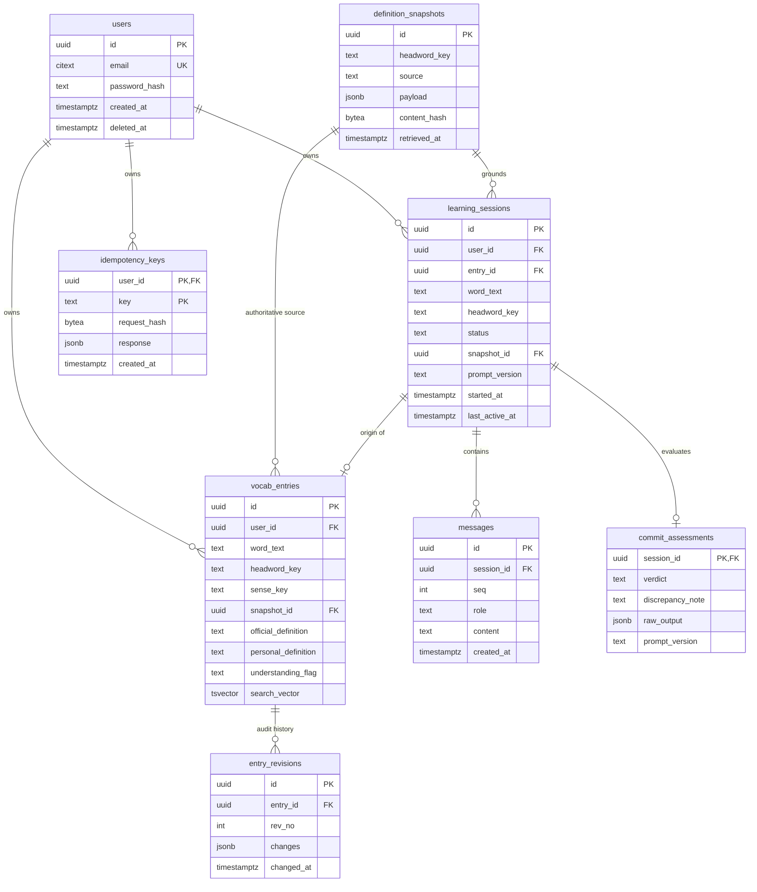

# Subject-Matter Guide: Database Schema Architecture & Type-Safe SQL (`sqlc`)

## 1. Concept & Systems 'Why'

### Why PostgreSQL Relational Modeling Over NoSQL?
Vocabulary learning systems are fundamentally relational and state-driven. A learner's journey requires strict consistency guarantees:
- A committed vocabulary item (`vocab_entries`) must never exist without an immutable lexical snapshot (`definition_snapshots`) and an origin session (`learning_sessions`).
- Committing a word, creating its first audit revision (`entry_revisions`), and marking the session as committed must succeed together or fail together—an atomic transaction that NoSQL document stores cannot guarantee without complex distributed transaction protocols.
- Full-text search and fuzzy typo correction must run close to the data engine without external sync delays (e.g., Elasticsearch clusters).

### Why `sqlc` Over Traditional ORMs?
In the Go ecosystem, developers often debate between ORMs (like GORM) and raw SQL (`database/sql`):
- **The ORM Problem:** ORMs rely on runtime reflection to map struct fields to columns. They obscure database execution plans, often produce N+1 query cascades, and make complex PostgreSQL features (like partial unique indexes or `tsvector` weighted search) awkward to express.
- **The Raw SQL Problem:** Writing strings like `db.Query("SELECT ...", args...)` gives you full SQL power, but offers zero compile-time type safety. If you rename a database column, your code compiles cleanly and crashes in production.
- **The `sqlc` Breakthrough:** `sqlc` parses pure SQL DDL and query files, validates them against PostgreSQL syntax rules, and compiles them into 100% type-safe Go structs and interfaces. If a query is invalid or types mismatch, compilation fails immediately at build time.

---

## 2. Relational Entity Architecture



---

## 3. Go & PostgreSQL Mechanics Deep-Dive

### 3.1 Immutable Snapshots & Cryptographic Hashing
To prevent dictionary updates from silently rewriting history:
- When lexical data is retrieved from third-party APIs, the backend normalizes the JSON and computes a SHA-256 hash (`content_hash BYTEA`).
- The table enforces `UNIQUE (source, headword_key, content_hash)`.
- If two users learn the same word sense, they share the immutable snapshot.

### 3.2 Single Active Session Enforcement via Partial Indexes
The SRS specifies that a user may have at most **one active learning session per word**:
```sql
CREATE UNIQUE INDEX one_active_session_per_word
    ON learning_sessions (user_id, headword_key) WHERE status = 'active';
```
*Why a partial index?* A standard unique index on `(user_id, headword_key)` would prevent a user from ever relearning a word or reviewing an abandoned session. By adding `WHERE status = 'active'`, PostgreSQL allows unlimited `committed` or `abandoned` sessions for a word, but strictly enforces that only one can be in flight simultaneously.

### 3.3 Weighted Full-Text Search (`tsvector`)
Rather than relying on naive `LIKE %query%` scans (which cannot use B-tree indexes and cause full table scans), `vocab_entries` uses a generated search vector:
```sql
search_vector TSVECTOR GENERATED ALWAYS AS (
    setweight(to_tsvector('english', word_text), 'A') ||
    setweight(to_tsvector('english', personal_definition), 'B') ||
    setweight(to_tsvector('english', coalesce(contextual_notes, '')), 'C')
) STORED
```
- **Weight A (Highest):** Matches on the actual word text.
- **Weight B:** Matches on the user's personal explanation.
- **Weight C:** Matches on notes or collocations.
- Coupled with a **GIN (Generalized Inverted Index)**, searches complete in under 500 ms across thousands of words (NFR-P3).

---

## 4. Verification & Testing Instructions

1. **Schema Syntax Validation:**
   Ensure PostgreSQL extensions and tables execute in order:
   ```bash
   # Run migration script against a PostgreSQL instance:
   psql -U postgres -d wordivate -f backend/sql/schema/001_init.sql
   ```
2. **Compile-Time Code Generation with SQLC:**
   ```bash
   cd backend
   sqlc generate
   ```
   *Expected outcome:* Generated files appear in `backend/internal/database/sqlc/`:
   - `models.go` (Go representations of all tables and custom types).
   - `db.go` (DBTX interface for connection pools and transactions).
   - Query files: `users.sql.go`, `sessions.sql.go`, `vocab_entries.sql.go`, etc.
