# Adaptive Recall & Practical Retention Engine

This document provides architectural, pedagogical, and technical documentation for Sprint 6 of the Wordivate backend in Go. It covers the spaced repetition algorithm (SM-2 adaptation), multi-tenant schedule persistence, lazy on-demand schedule seeding, Clean Architecture decoupling, and review audit logging.

---

## 1. Concept & Systems 'Why'

### 1.1 The Systems Problem: Active Retrieval vs. Passive Storage
In vocabulary acquisition, saving a word to a database is only the initial step. Cognitive science demonstrates that memory decay follows Ebbinghaus's forgetting curve: without targeted retrieval practice, memory retention falls below 20% within several weeks.

*Think of it like progressive overload in strength training:*
> If an athlete only reads workout manuals or looks at barbells, muscles do not grow. Strength develops exclusively when the nervous system and muscles are forced to exert physical effort against resistance right before fatigue sets in. Similarly, long-term lexical retention does not happen through passive re-reading of dictionary entries; it requires effortful cognitive retrieval practice scheduled just as the memory begins to fade.

Standard flashcard applications frequently create artificial fluency by prompting recognition rather than genuine recall. Wordivate grounds its spaced retrieval engine in the learner's own committed mental model:
1. Every review item presents the word, part of speech, official definition, and the learner's own `personal_definition` and contextual notes.
2. The user evaluates their recall difficulty on a 0–5 SuperMemo scale.
3. The system calculates the subsequent review date and expands or contracts the interval dynamically.

### 1.2 The SuperMemo-2 (SM-2) Adaptation
The SM-2 algorithm models learner retention through three state variables:
- **Repetitions ($n$):** Consecutive successful reviews ($q \ge 3$).
- **Ease Factor ($EF$):** Multiplier indicating how easily the learner recalls the item (default $2.50$, clamped at a minimum floor of $1.30$).
- **Interval ($I$):** Days until the next review.

The algorithm calculates updated parameters based on the learner's recall grade $q \in [0, 5]$:

$$\begin{aligned}
EF' &= EF + (0.1 - (5 - q) \times (0.08 + (5 - q) \times 0.02)) \\
EF' &= \max(EF', 1.30)
\end{aligned}$$

Interval progression:
- **Recall Failure ($q < 3$):** The repetition counter resets to $0$, and the interval resets to $1$ day ($I' = 1$), while the Ease Factor is penalized.
- **Recall Success ($q \ge 3$):** Repetitions increment ($n' = n + 1$):
  - If $n' = 1$: $I' = 1 \text{ day}$.
  - If $n' = 2$: $I' = 6 \text{ days}$.
  - If $n' > 2$: $I' = \text{round}(I \times EF')$.

### 1.3 Clean Architecture Decoupling (Refactoring Legacy Violations)
A critical requirement of Sprint 6 was eliminating architectural debt in `backend/internal/features/recall/`. In legacy code, `service.go` directly injected `*database.DB`:
```go
// ARCHITECTURAL VIOLATION: Directly coupling domain service to database driver
type service struct {
    db *database.DB
}
```
Sprint 6 refactors the package into a strict 4-tier Clean Architecture:
- **Transport (`handler.go`):** Translates HTTP JSON requests, validates headers/JWT claims, and writes HTTP status codes.
- **Domain Service (`service.go`):** Implements pure business logic, SM-2 mathematical calculations, and multi-tenant security verification.
- **Repository Interface (`repository.go`):** Abstract persistence contract allowing 100% isolated mocking in unit tests without database overhead.
- **Data Access (`backend/internal/database/sqlc/`):** Compile-time verified PostgreSQL SQLC queries.

```go
// CLEAN ARCHITECTURE: Domain service depends exclusively on abstract Repository interface
type service struct {
    repo Repository
}
```

### 1.4 Lazy On-Demand Schedule Seeding
When words are committed to `vocab_entries`, creating review schedules via background batch cron jobs introduces complexity, background daemon dependencies, and synchronization delays.

Wordivate implements **lazy on-demand seeding**:
When a learner calls `GET /v1/recall/due`, the service first executes an idempotent initialization query:
```sql
INSERT INTO recall_schedules (entry_id, user_id, interval_days, ease_factor, repetition_count, next_review_at)
SELECT ve.id, ve.user_id, 1, 2.5, 0, now()
FROM vocab_entries ve
LEFT JOIN recall_schedules rs ON ve.id = rs.entry_id
WHERE ve.user_id = $1 AND rs.entry_id IS NULL
ON CONFLICT (entry_id) DO NOTHING;
```
This guarantees:
1. Zero lag between tapping **Commit** and seeing the item appear in the recall queue.
2. Complete absence of external background worker dependencies.
3. Absolute multi-tenant isolation via the `WHERE ve.user_id = $1` filter.

---

## 2. Go Implementation Deep-Dive

### 2.1 SM-2 Calculation & Float Rounding
SuperMemo ease factors are continuous values that can produce floating-point precision drift in Go (`2.4999999999999996`). To maintain clean database storage and predictable interval calculation, the service rounds $EF'$ to two decimal places and guarantees interval progression:

```go
func (s *service) CalculateNextReview(interval int, easeFactor float64, repetitions int, rating int) (int, float64, int, time.Time) {
    if rating < 0 {
        rating = 0
    } else if rating > 5 {
        rating = 5
    }

    if easeFactor < MinEaseFactor {
        easeFactor = MinEaseFactor
    }

    q := float64(rating)
    newEase := easeFactor + (0.1 - (5.0-q)*(0.08+(5.0-q)*0.02))
    if newEase < MinEaseFactor {
        newEase = MinEaseFactor
    }
    newEase = math.Round(newEase*100) / 100

    var nextInterval int
    var newReps int

    if rating < 3 {
        newReps = 0
        nextInterval = 1
    } else {
        newReps = repetitions + 1
        switch newReps {
        case 1:
            nextInterval = 1
        case 2:
            nextInterval = 6
        default:
            calc := float64(interval) * newEase
            nextInterval = int(math.Round(calc))
            if nextInterval <= interval {
                nextInterval = interval + 1
            }
        }
    }

    nextReview := time.Now().AddDate(0, 0, nextInterval)
    return nextInterval, newEase, newReps, nextReview
}
```

### 2.2 Atomic Review Logging & Schedule Updates
When a review is submitted, recording the audit event (`recall_reviews`) and updating the scheduling state (`recall_schedules`) must occur atomically:

```go
func (r *sqlRepository) SaveReviewAndSchedule(ctx context.Context, params SaveReviewParams) (*ReviewResult, error) {
    tx, err := r.db.BeginTx(ctx, nil)
    if err != nil {
        return nil, err
    }
    defer tx.Rollback()

    qtx := r.q.WithTx(tx)

    // 1. Upsert updated schedule
    sched, err := qtx.UpsertRecallSchedule(ctx, sqlc.UpsertRecallScheduleParams{ ... })
    if err != nil {
        return nil, err
    }

    // 2. Append review event audit log
    _, err = qtx.CreateRecallReview(ctx, sqlc.CreateRecallReviewParams{ ... })
    if err != nil {
        return nil, err
    }

    if err := tx.Commit(); err != nil {
        return nil, err
    }

    return &ReviewResult{ ... }, nil
}
```

---

## 3. Architecture & Visual Flow



### 3.1 Step-by-Step Flow Walkthrough
1. **Request Due Words:** The client issues `GET /v1/recall/due` with a valid JWT Bearer token.
2. **Authentication:** The `RequireUserID` middleware validates claims and extracts `userID` as a `uuid.UUID`.
3. **Lazy Seeding:** The `recall.Service` triggers `EnsureSchedulesForUser` to seed any unindexed entries for that tenant.
4. **Urgency-Ordered Query:** PostgreSQL returns rows where `next_review_at <= now()`, ordered by `next_review_at ASC`.
5. **Presentation:** The learner receives the vocabulary item along with their personal definition and example sentence.
6. **Recall Evaluation:** The learner self-assesses their retrieval performance ($0$ = blackout, $5$ = perfect recall) and posts to `POST /v1/recall/reviews`.
7. **Ownership Verification:** The service verifies that `entry_id` belongs to `userID`. If unowned or missing, HTTP 404 is returned.
8. **SM-2 Calculation:** The service retrieves the current schedule and computes the updated interval and Ease Factor.
9. **Atomic Persistence:** The repository writes both the updated schedule and the review audit record within a single database transaction.
10. **Confirmation:** The server responds with HTTP 200 OK containing the new interval and scheduled timestamp.

---

## 4. Drawbacks & Trade-offs

| Design Decision | Approach Chosen | Alternative & Reason Rejected |
| :--- | :--- | :--- |
| **Relational Storage** | Dedicated `recall_schedules` 1:1 table | Storing review fields directly on `vocab_entries`. Rejected: Polutes the lexical entity with ephemeral scheduling state; violates Single Responsibility Principle. |
| **Algorithm Selection** | Classic SM-2 with clamped $EF \ge 1.30$ | FSRS (Free Spaced Repetition Scheduler) / Neural SRS. Rejected: High computational complexity and extensive parameter tuning requirements unjustified for early stage vocabulary acquisition. |
| **Schedule Seeding** | Lazy on-demand seeding on `GET /due` | Background Redis / Celery / Cron worker. Rejected: Eliminates operational dependencies on background workers and prevents queue-lag or out-of-sync race conditions. |
| **Float Precision** | Rounding Ease Factor to 2 decimal places | Storing raw `float64` precision. Rejected: Prevents IEEE 754 precision drift (`2.4999999999999996`) across database roundtrips and simplifies unit test verification. |

---

## 5. Verification & Testing Strategy

### 5.1 Automated Unit Tests
Run the dedicated recall test suite with coverage:
```bash
cd backend
go test -v -cover ./internal/features/recall/...
```
**Outcome:**
- Statements covered: **>90%** of domain service logic (`service.go`) and **100%** of HTTP handler logic (`handler.go`).
- Verified test cases:
  - Ease Factor minimum floor clamp ($EF \ge 1.30$).
  - Review score clamping ($[0, 5]$ bounds).
  - Interval progression for $n=0 \to 1$, $n=1 \to 2$, and $n > 2$.
  - Interval and repetition counter reset upon recall failure ($q < 3$).
  - Multi-tenant tenant verification and unowned word rejection (HTTP 404).
  - Malformed payload rejection (HTTP 400).
  - Unauthenticated access rejection (HTTP 401).

### 5.2 Whole Backend Regression Suite
Run full test suite across all packages:
```bash
go test ./...
```
**Outcome:** All feature packages (`auth`, `capture`, `library`, `recall`, `socratic`, `middleware`) pass with zero regressions.

### 5.3 Manual cURL Verification
```bash
# 1. Fetch Due Words
curl -X GET http://localhost:8080/v1/recall/due \
  -H "Authorization: Bearer <VALID_JWT_TOKEN>"

# Expected Response:
# {
#   "words": [
#     {
#       "id": "c138d689-53e7-497d-b19c-9c9aa8e38d7a",
#       "term": "ephemeral",
#       "official_definition": "lasting for a very short time",
#       "personal_definition": "something that vanishes quickly like morning dew",
#       "part_of_speech": "adjective",
#       "interval_days": 1,
#       "ease_factor": 2.5,
#       "repetition_count": 0,
#       "next_review": "2026-10-19T12:00:00Z"
#     }
#   ],
#   "count": 1
# }

# 2. Submit Recall Review (Rating: 4 - Good Recall)
curl -X POST http://localhost:8080/v1/recall/reviews \
  -H "Authorization: Bearer <VALID_JWT_TOKEN>" \
  -H "Content-Type: application/json" \
  -d '{
    "word_id": "c138d689-53e7-497d-b19c-9c9aa8e38d7a",
    "rating": 4
  }'

# Expected Response:
# {
#   "entry_id": "c138d689-53e7-497d-b19c-9c9aa8e38d7a",
#   "repetition_count": 1,
#   "interval_days": 1,
#   "ease_factor": 2.5,
#   "next_review_at": "2026-10-20T12:00:00Z",
#   "reviewed_at": "2026-10-19T12:00:00Z"
# }
```
