# Socratic Conversation Engine & Real-Time SSE Streaming

This document provides architectural, pedagogical, and technical documentation for Sprint 4 of the Wordivate backend in Go. It covers the Socratic tutor state machine, prompt assembly, real-time Server-Sent Events (SSE) transport, append-only message sequencing, and inactivity reclamation.

---

## 1. Concept & Systems 'Why'

### 1.1 The Pedagogical Problem: Passive Answers vs. Mental Models
Standard AI chatbots suffer from two major flaws when applied to vocabulary learning:
1. **Unconstrained Encyclopedic Output:** If a user asks about a word, typical models dump an encyclopedia of definitions, etymologies, and examples. The learner nods passively, but fails to construct a lasting mental model.
2. **False Confirmation (AI-002):** When a user responds with *"yes"*, *"got it"*, or *"makes sense"*, generic chatbots cheerfully assume comprehension. In reality, passive agreement is **never** evidence of mastery.

Wordivate solves this by enforcing an adaptive Socratic state machine:
- Probes user understanding through context-rich queries.
- Strictly refuses to confirm comprehension without demonstrated evidence (an original sentence, contrast with synonyms, or everyday paraphrase).
- Enforces the **Two-Strike Fallback (FR-013)**: If the learner struggles twice or explicitly says *"just tell me"*, the tutor immediately halts Socratic questioning and provides a vivid, direct explanation before inviting an application.

### 1.2 Transport Selection: Why Server-Sent Events (SSE) Over WebSockets?
*Think of it like a radio broadcast versus a two-way phone call.*
- **WebSockets:** Full-duplex bidirectional communication over TCP. Necessary for real-time multiplayer games or collaborative whiteboards where both client and server emit continuous, asynchronous packets over the same pipe.
- **Server-Sent Events (SSE):** Standard HTTP unidirectional streaming from server to client.
  - The client sends a standard HTTP request (`POST /v1/sessions/{id}/messages`).
  - The server holds the connection open, returning `Content-Type: text/event-stream`, and streams text chunks as standard W3C text events (`event: token\ndata: ...\n\n`).
  - **Why SSE wins for Wordivate:**
    1. **HTTP/2 & HTTP/3 Native:** Operates seamlessly over standard HTTP ports (80/443), passing through strict enterprise proxies and mobile firewalls that frequently throttle or drop raw WebSocket handshakes.
    2. **Middleware Compatibility:** Reuses standard HTTP auth (`Authorization: Bearer <token>`), request IDs, tracing, and logging middleware without special sub-protocol negotiation.
    3. **Lower Complexity & Resource Footprint:** No connection upgrade negotiation or ping/pong heartbeat keepalive state machines in application code.

### 1.3 Monotonic Sequential Ordering (`seq`)
In multi-turn chat applications, network packet reordering and clock drift make timestamps unreliable for message ordering. 
Wordivate enforces an append-only integer sequence number (`seq = 1, 2, 3...`) backed by a unique composite constraint `(session_id, seq)` in PostgreSQL:
- User turn: `seq = last_seq + 1`
- Assistant reply: `seq = last_seq + 2`
This guarantees deterministic client replay and prevents race conditions.

---

## 2. Go Implementation Deep-Dive

### 2.1 Concurrency & Streaming with Channels and Context
The Go runtime's lightweight goroutines and CSP (Communicating Sequential Processes) channels provide an ideal foundation for real-time streaming:

```go
func (s *socraticService) PostUserMessage(ctx context.Context, userID, sessionID uuid.UUID, content string) (<-chan StreamEvent, error) {
    // ... validation and persistence ...
    llmChan, err := s.llmClient.StreamChat(ctx, chatReq)
    outChan := make(chan StreamEvent, 32)

    go func() {
        defer close(outChan)
        var fullResponse strings.Builder
        tokenCount := 0

        for event := range llmChan {
            if event.Type == StreamEventToken {
                fullResponse.WriteString(event.Token)
                tokenCount++
                event.Seq = assistantSeq
            }
            select {
            case <-ctx.Done():
                return // Client disconnected
            case outChan <- event:
            }
        }
        
        // Detached persistence context
        saveCtx, cancel := context.WithTimeout(context.Background(), 5*time.Second)
        defer cancel()
        _, _ = s.repo.CreateMessage(saveCtx, sessionID, assistantSeq, RoleAssistant, fullResponse.String(), &tc)
        _ = s.repo.UpdateSessionLastActive(saveCtx, sessionID, userID)
    }()

    return outChan, nil
}
```

#### Key Engineering Decisions:
1. **Detached Context for Assistant Persistence:** Notice that while the stream listens to the client's `ctx.Done()`, persisting the final assistant message uses `context.Background()` with a 5-second timeout. If the user disconnects or locks their screen on the very last token, the completed AI message is **not lost or corrupted**, preserving data integrity.
2. **Channel Directionality:** The service returns a read-only channel (`<-chan StreamEvent`), preventing the transport handler from accidentally writing to or closing the internal channel.

### 2.2 Standard Library `http.Flusher`
Instead of pulling in third-party SSE frameworks, Wordivate leverages Go's standard library `http.Flusher` interface:

```go
flusher, ok := w.(http.Flusher)
if !ok {
    middleware.ErrorJSON(w, http.StatusInternalServerError, "streaming unsupported")
    return
}

w.Header().Set("Content-Type", "text/event-stream")
w.Header().Set("Cache-Control", "no-cache")
w.Header().Set("Connection", "keep-alive")
w.Header().Set("X-Accel-Buffering", "no")
w.WriteHeader(http.StatusOK)
flusher.Flush()
```
Setting `X-Accel-Buffering: no` instructs reverse proxies (such as Nginx) not to buffer chunks, ensuring sub-second token delivery to the mobile client.

### 2.3 Embedded Versioned Prompts (`//go:embed`)
System prompts are source-controlled in `backend/internal/features/socratic/prompts/` and embedded directly into the Go executable via standard library `embed.FS`:
- Eliminates filesystem path dependencies and missing-file errors in Docker or cloud deployments.
- Every session records its `prompt_version` (e.g., `v1.0`), ensuring complete reproducibility for AI evaluation benchmarks.

---

## 3. Architecture & Lifecycle Flows

### 3.1 Socratic Turn & SSE Streaming Lifecycle



#### Step-by-Step Architectural Walkthrough:
1. **Client Dispatches Message:** Learner submits user reflection via `POST /v1/sessions/{id}/messages`.
2. **Auth Verification:** Socratic handler inspects JWT claims and authenticates the user context.
3. **Sequence Counter Synchronization:** Service fetches current session state and determines next sequential message number (`seq`).
4. **User Message Persistence:** Message is inserted with `seq=1`, `role='user'` into PostgreSQL.
5. **Contextual Grounding:** Service retrieves immutable dictionary senses from the cached `definition_snapshots` record.
6. **Policy Evaluation:** Tutor engine verifies the Two-Strike rule (evaluating past misunderstandings) and renders prompt template `v1.0`.
7. **Streaming Channel Handshake:** LLM client exposes `<-chan StreamEvent`, which service proxies directly to the HTTP handler.
8. **SSE Protocol Handshake:** Handler responds with HTTP 200, setting `Content-Type: text/event-stream` and disabling reverse-proxy buffering (`X-Accel-Buffering: no`).
9. **Sub-second Token Emission:** As tokens arrive from the LLM, handler flushes SSE chunks immediately via `http.Flusher`.
10. **Session Sealing:** Upon stream termination (`EOF`), assistant response is persisted (`seq=2`, `role='assistant'`) and a terminal `done` event is broadcast to the client.

### 3.2 Session Lifecycle State Machine



#### Lifecycle State Descriptions:
- **`ACTIVE`:** Initialized upon word capture (`POST /v1/sessions`). Supports bidirectional Socratic turns and SSE token streaming.
- **`COMMITTING`:** Triggered when learner reviews comprehension and requests commit assessment (`POST /commit-draft`).
- **`COMMITTED`:** Terminal state reached when atomic database transaction successfully persists entry into `vocab_entries` and registers audit revision 1.
- **`ABANDONED`:** Automatic transition upon 30-minute inactivity timeout or explicit user cancellation, freeing the active session constraint.
- **`FAILED`:** Unrecoverable upstream error or AI provider outage.

---

## 4. Verification & Testing

### 4.1 Running the Automated Test Suite
Run the unit test suite covering Socratic state transitions, two-strike triggers, context cancellation, and SSE handler streaming:

```bash
cd backend
go test -v -cover ./internal/features/socratic/...
```

Expected result: All tests pass with service coverage > 90%.

### 4.2 Manual Verification with `curl`

#### Step 1: Login and obtain a JWT token
```bash
curl -X POST http://localhost:8080/v1/auth/login \
  -H "Content-Type: application/json" \
  -d '{"email": "learner@wordivate.com", "password": "password123"}'
```

#### Step 2: Initialize a Socratic Session
```bash
curl -X POST http://localhost:8080/v1/sessions \
  -H "Authorization: Bearer <TOKEN>" \
  -H "Content-Type: application/json" \
  -d '{"word_text": "ephemeral", "context_note": "Read in philosophy essay"}'
```
Note the returned `session_id`.

#### Step 3: Stream an Interactive Turn over SSE
```bash
curl -N -X POST http://localhost:8080/v1/sessions/<SESSION_ID>/messages \
  -H "Authorization: Bearer <TOKEN>" \
  -H "Content-Type: application/json" \
  -d '{"content": "I noticed morning fog is ephemeral because it disappears once the sun rises."}'
```
Observe real-time `event: token` streaming immediately in your terminal without buffering, terminating with `event: done`.

#### Step 4: Verify Session Message History
```bash
curl -X GET http://localhost:8080/v1/sessions/<SESSION_ID> \
  -H "Authorization: Bearer <TOKEN>"
```
Returns both the user turn (`seq: 1`) and the tutor's response (`seq: 2`).

#### Step 5: Explicitly Abandon Session (SRS §8.2)
```bash
curl -X POST http://localhost:8080/v1/sessions/<SESSION_ID>/abandon \
  -H "Authorization: Bearer <TOKEN>"
```
Transitions status from `active` to `abandoned`, sets `ended_at = now()`, and returns HTTP 200 OK with the updated session.

#### Step 6: Resume Abandoned Session (SRS §8.2)
```bash
curl -X POST http://localhost:8080/v1/sessions/<SESSION_ID>/resume \
  -H "Authorization: Bearer <TOKEN>"
```
Verifies no active session conflict exists for the headword, transitions status back to `active`, clears `ended_at = NULL`, and returns HTTP 200 OK.

